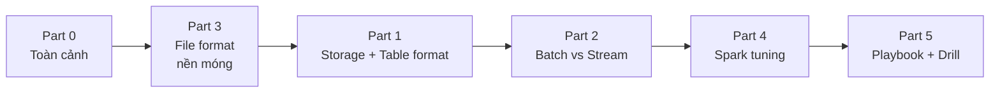

# Deep Dive Data Systems — Ôn phỏng vấn Senior Data Engineer

Bộ tài liệu cô đọng, viết bằng tiếng Việt, tổng hợp từ **docs chính thức** (hadoop.apache.org, docs.delta.io, iceberg.apache.org, parquet.apache.org, avro.apache.org, spark.apache.org) và các bài viết phổ biến trên Medium về lakehouse, table format và Spark tuning.

## Mục tiêu

- Hiểu **vì sao** các hệ thống thiết kế như vậy, không chỉ "là gì" — mức câu hỏi của vòng Senior.
- Trả lời được dạng câu: *trade-off*, *khi nào chọn gì*, *chẩn đoán sự cố*.
- Mỗi part kết thúc bằng **câu chốt 30 giây** + **câu hỏi phỏng vấn thường gặp**.

## Cấu trúc

| File | Nội dung | Từ khóa chính |
|---|---|---|
| [Part 0 — Overview](part-0-overview.md) | Bức tranh toàn cảnh: vì sao có data lakehouse | storage-compute separation |
| [Part 1 — Distributed Storage](part-1-distributed-storage.md) | HDFS → S3 → Delta → Iceberg → Hudi | ACID, COW vs MOR, hidden partitioning |
| [Part 2 — Batch vs Stream](part-2-batch-vs-stream.md) | Event time, watermark, semantics, Lambda/Kappa | exactly-once, windowing |
| [Part 3 — Storage Formats](part-3-storage-formats.md) | Parquet, Avro, ORC; row vs columnar | predicate pushdown, schema evolution |
| [Part 4 — Spark Optimization](part-4-spark-optimization.md) | Chẩn đoán Spark UI 5 bước, 9 bệnh thường gặp | skew, shuffle, spill, Kryo, broadcast |
| [Part 5 — Interview Playbook](part-5-interview-playbook.md) | Câu chốt từng chủ đề, map vào CV, drill tự kiểm chứng | STAR, self-verification |

## Lộ trình ôn (khuyến nghị 5 buổi)

Part 3 đặt trước Part 1 khi ôn vì row group / columnar / footer statistics là nền để hiểu vì sao Delta/Iceberg làm được time travel và partition pruning.

## Nguồn đối chiếu chính

- HDFS: <https://hadoop.apache.org/docs/stable/hadoop-project-dist/hadoop-hdfs/HdfsDesign.html>
- Delta Lake: <https://docs.delta.io/latest/delta-batch.html> · <https://docs.delta.io/latest/delta-update.html>
- Iceberg: <https://iceberg.apache.org/docs/latest/partitioning/> · <https://iceberg.apache.org/docs/latest/table-migration/>
- Parquet: <https://parquet.apache.org/docs/file-format/> · <https://parquet.apache.org/docs/concepts/>
- Avro: <https://avro.apache.org/docs/1.11.3/specification/>
- Spark Tuning: <https://spark.apache.org/docs/latest/tuning.html>
