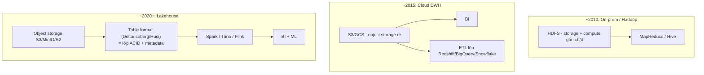

# Part 0 — Overview: Bức tranh toàn cảnh của Data Systems

> Câu hỏi mở đầu mọi phỏng vấn Senior: *"Tell me about the modern data stack / why lakehouse?"* — Trả lời bằng 1 câu chuyện, không liệt kê công nghệ.

## 1. Ba thời kỳ của kiến trúc dữ liệu



| Thời kỳ | Giải quyết được | Vấn đề để lại |
|---|---|---|
| Hadoop/HDFS | Lưu file lớn rẻ, scale-out | Storage gắn compute → khó scale độc lập; nhỏ dần theo thời đại cloud |
| Cloud DWH | Compute mạnh, SQL chuẩn | Vendor lock-in, chi phí tăng theo data volume; ML khó đọc data thô |
| Lakehouse | Storage rẻ (object store) + **bảng ACID** + multi-engine | Cần hiểu sâu table format, maintenance (compaction, snapshots) |

## 2. Ý tưởng trung tâm: tách storage khỏi compute

```
┌─────────────────────────────────────────────────────┐
│  Compute: Spark, Trino, Flink, DuckDB...            │  scale độc lập,
│  (stateless, đọc metadata rồi đọc data)             │  giờ cao điểm
├─────────────────────────────────────────────────────┤
│  Table format: Delta / Iceberg / Hudi               │  ACID, time travel,
│  (metadata: schema, snapshot, partition spec)       │  schema evolution
├─────────────────────────────────────────────────────┤
│  Object storage: S3 / MinIO / GCS / R2              │  rẻ, virtually
│  (chỉ PUT/GET/LIST — không ACID, không rename)      │  unlimited
└─────────────────────────────────────────────────────┘
```

**Insight để "ghi điểm":** Object storage rẻ nhưng *kém* về tính nguyên tố (atomicity). Table format sinh ra chính là để **bù phần atomic commit + metadata** mà object storage thiếu. Đó là lý do cả ba format (Delta, Iceberg, Hudi) đều tồn tại và giống nhau về mặt mục tiêu.

## 3. Bản đồ kiến thức — 4 tầng cần thuộc

| Tầng | Câu hỏi cốt lõi | Part |
|---|---|---|
| **File format** (Parquet, Avro, ORC) | Dữ liệu nằm trong 1 file như thế nào? Vì sao analytic query nhanh với columnar? | [Part 3](part-3-storage-formats.md) |
| **Distributed storage** (HDFS, S3) | Dữ liệu phân phối, replica, consistency ra sao? Giới hạn gì? | [Part 1](part-1-distributed-storage.md) |
| **Table format** (Delta, Iceberg, Hudi) | Nhiều file rời trở thành 1 bảng ACID bằng cách nào? | [Part 1](part-1-distributed-storage.md) |
| **Processing** (Spark, Flink) | Batch vs stream, tối ưu execution thế nào? | [Part 2](part-2-batch-vs-stream.md), [Part 4](part-4-spark-optimization.md) |

## 4. Mạch logic khi trả lời phỏng vấn

1. **Bắt đầu từ bài toán**: dữ liệu lớn → cần phân mảnh + replica → HDFS (Part 1).
2. **Cloud làm rẻ storage** nhưng mất atomicity → readers thấy data dở dang → cần table format (Part 1).
3. **Dữ liệu vào lake qua streaming hoặc batch** → chọn mô hình + semantics phù hợp (Part 2).
4. **Tầng file quyết định hiệu năng đọc** → Parquet cho analytic, Avro cho ingestion (Part 3).
5. **Khi chậm thì chẩn đoán có hệ thống**, không đoán mò config (Part 4).
6. **Neo vào trải nghiệm thật** của bản thân (Part 5).

## Câu chốt 30 giây

> "Lakehouse = object storage rẻ + 1 lớp table format đóng vai trò 'transaction log' để mang ACID, schema evolution và time travel xuống data lake, cho phép nhiều engine (Spark, Trino, Flink) cùng đọc ghi một nguồn dữ liệu trung thực duy nhất."

## Câu hỏi thường gặp

- Vì sao không dùng DWH thuần cho mọi thứ? *(chi phí volume lớn, ML cần data thô, lock-in)*
- Iceberg/Delta khác gì Parquet? *(file format vs table format — Parquet là viên gạch, table format là toàn tòa nhà + sổ quản lý)*
- Đã dùng pattern này ở đâu trong dự án thật chưa? *(chuẩn bị theo Part 5)*

*[← README](README.md) · [Part 1 →](part-1-distributed-storage.md)*
