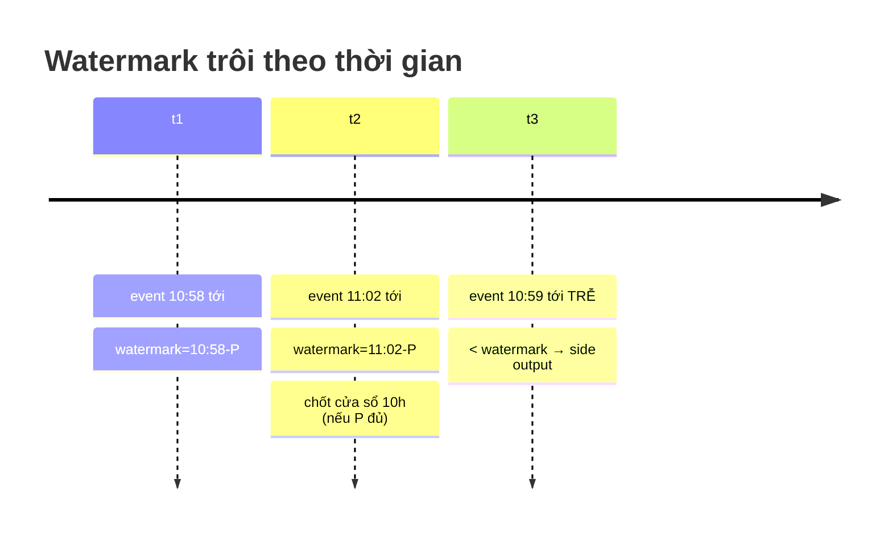

# Part 2 — Batch vs Stream: thời gian, cửa sổ và độ tin cậy

> Nguồn đối chiếu: Spark Structured Streaming Programming Guide · Flink docs (Event Time / Watermarks) · Kafka docs (delivery semantics)

## 1. Bảng quyết định: khi nào batch, khi nào stream

| Tiêu chí | Batch | Stream (micro-batch / true streaming) |
|---|---|---|
| Latency yêu cầu | Phút–giờ (dashboard ngày, báo cáo tài chính) | Giây–phút (cảnh báo, personalization, monitoring) |
| Chi phí vận hành | Thấp (chạy theo lịch) | Cao (job chạy 24/7, recovery, backfill) |
| Độ phức tạp correctness | Đơn giản (data đã "đóng băng") | Phức tạp (out-of-order, duplicate, late data) |
| Bài toán điển hình | ELT/DWH, báo cáo BOD, đối soát | CDC, fraud detection, IoT, clickstream |
| Thay đổi schema | Xử lúc deploy | Phải xử "nóng" (schema registry) |

**Đáp án Senior**: không binary — *pipeline hỗn hợp*: stream cho near-real-time needs, batch như "source of truth" reprocessing được (hoặc giờ: một engine duy nhất — Flink / Spark Structured Streaming — chạy cả hai vai).

## 2. Event time vs Processing time (khái niệm sống còn)

```
Event time    = thời gian sự kiện XẢY RA (ghi trong data: event_ts)
Processing time = thời gian sự kiện ĐẠT tới hệ thống (wall-clock của consumer)

Ví dụ: event occurring 10:59:58 (event time) nhưng network chậm,
       tới consumer lúc 11:00:30 (processing time) → có nên nằm trong
       cửa sổ 10h hay 11h?

   Event-time axis ─────────►
   ├──────── window 10h ─────┤──────── window 11h ─────┤
        e1   e2    e3              e4        e5(!)
   Processing-time axis ─────────►
        e1   e2      e3   e4       e5   ← e3,e5 đến trễ/xen ngang
```

- Chọn processing time = đơn giản nhưng **sai** khi có trễ (mobile offline, retry, backfill) — kết quả không deterministic.
- Chọn event time = đúng theo nghiệp vụ (doanh thu thuộc tháng nào) nhưng phải xử lý **out-of-order** → cần **watermark**.

## 3. Windowing — 4 loại cần thuộc

| Loại | Hình dung | Use case |
|---|---|---|
| **Tumbling** | Cửa sổ liền nhau không giao nhau `[0,5), [5,10)` | Doanh thu mỗi 5 phút |
| **Sliding** | Trượt, giao nhau, kích thước ≠ bước trượt | "SLA mỗi 1h, cập nhật mỗi 1 phút" |
| **Session** | Bắt đầu khi có event, đóng sau gap ≥ inactivity | User session web/app, phiên quét RFID |
| **Global** | 1 cửa sổ vô tận + trigger định kỳ | Rolling metrics |

```
Tumbling:  |----w1----|----w2----|----w3----|
Sliding:   |--w1--|
              |--w2--|
                |--w3--|          (step < size)
Session:   |e e e ---gap--- e e|  (gap > inactivity → cửa mới)
```

## 4. Watermark — "hẹn giờ đóng cửa sổ"

- Định nghĩa thực dụng: `watermark = max_event_time_seen − allowed_lateness`.
- Nghĩa: *"Tôi cam kết không còn event nào có event_time < watermark đến nữa — hãy chốt cửa sổ, emit kết quả, dọn state."*
- Trade-off (phải nói được): allowed_lateness **lớn** → chính xác nhưng state giữ lâu (memory), cửa sổ đóng chậm; **nhỏ** → tiết kiệm nhưng drop/delay data trễ.
- Data đến sau watermark: drop, hoặc ghi sang **side output** xử riêng (đẩy sang bảng late-arriving rồi batch merge lại).



## 5. Delivery semantics — 3 mức

| Mức | Cách đạt | Rủi ro | Use case |
|---|---|---|---|
| **At-most-once** | Gửi xong quên, crash không retry | Mất dữ liệu | Metrics không quan trọng |
| **At-least-once** | Retry + acknowledge **sau khi** xử lý | Trùng dữ liệu | Hầu hết pipeline (chuẩn mặc định) |
| **Exactly-once** | At-least-once **+** xử lý idempotent hoặc sink transactional | Tốn nguồn, phức tạp | Thanh toán, Dedup CDC |

**Điểm phân biệt Senior** — exactly-once có 2 lớp, đừng nhầm:

1. **Trong hệ thống stream** (internal): checkpoint + replay từ offset (Flink checkpoint, Kafka transaction giữa source→sink, Spark Structured Streaming `foreachBatch` + idempotent sink).
2. **End-to-end tới downstream**: chỉ có khi **sink idempotent** (upsert theo key — Iceberg/Hudi MERGE, DELETE+INSERT theo PK) hoặc **transactional** (ghi commit cùng transaction với offset).

> "Exactly-once không phải là magic của engine — nó là hợp đồng giữa engine và sink."

**Câu về Kafka thường gặp**: Kafka cho exactly-once được không? → *Có, giới hạn trong Kafka Streams (read-process-write trong Kafka, `enable.idempotence` + transaction); một khi chạm hệ thống ngoài thì phải tự idempotent.*

## 6. Lambda vs Kappa

### Lambda (2014, Nathan Marz)

```
        ┌── Batch layer:  batch job (Spark)  ──►  batch views  ─┐
 source │                                                        ├──►  merge/serving
        └── Speed layer:  stream job (Flink/Storm) ──► realtime ─┘
```

- Batch layer = chính xác, tính lại toàn bộ (recompute); speed layer = nhanh nhưng thô, bị ghi đè.
- **Nỗi đau**: **2 codebase** cho cùng logic → drift, test gấp đôi, data mismatch giữa 2 tầng.

### Kappa (2015, Jay Kreps — LinkedIn)

```
 source(Kafka, retention dài) ──►  chỉ 1 stream processing engine ──►  serving
        │
        └─ reprocess = chạy job thứ 2 từ offset 0, xong switch, tắt job cũ
```

- Điều kiện: log (Kafka) giữ data đủ lâu để replay; mọi logic biểu diễn được như stream.
- **Nỗi đau**: mọi thứ phải live trong "thế giới streaming" — một số analytics nặng (ML training, full join lịch sử) vẫn tự nhiên hơn ở batch.

| | Lambda | Kappa |
|---|---|---|
| Codebase | 2 (batch + speed) | 1 (stream) |
| Correctness | Batch layer chuẩn gold | Phụ thuộc chất lượng stream logic |
| Reprocessing | Tự nhiên | Replay từ log (cần retention) |
| Phức tạp ops | Cao (sync 2 tầng) | Trung bình |
| Khi nào vẫn chọn Lambda | Analytics nặng + SLA real-time | Log đủ dài + use case thuần event |

**Ghi chú hiện đại (2025+)**: ranh giới mờ dần — Spark Structured Streaming/Flink xử both, table format (Iceberg/Delta) đóng vai trò state bền vững cho streaming → kiến trúc thực tế thường là *Kappa + bảng lakehouse làm batch layer ngầm*.

## 7. Câu chốt 30 giây từng khái niệm

- **Event time**: *"Tôi gắn kết quả với thời gian nghiệp vụ, nên dù event đến trễ vẫn về đúng cửa sổ của nó — watermark là cam kết chốt cửa sổ."*
- **Watermark**: *"Khoảng thời gian chờ cuối cùng — dài thì chính xác nhưng tốn state, ngắn thì nhanh nhưng mất event trễ."*
- **Exactly-once**: *"At-least-once cộng với sink idempotent hoặc transactional; engine chỉ đảm bảo trong nội bộ của nó."*
- **Kappa**: *"Giữ nguyên log đủ lâu thì chỉ cần một codebase — reprocess là replay."*

## 8. Câu hỏi phỏng vấn thường gặp

1. Khách cần dashboard "cập nhật mỗi 5 phút" → batch hay stream? *(Trick: vẫn là micro-batch 5 phút — rẻ hơn streaming đúng nghĩa)*
2. Cửa sổ 1h mà event đến trễ 10 phút? *(Watermark/allowed-lateness; side output cho trễ quá giới hạn)*
3. Đảm bảo không trùng dòng khi consumer restart? *(Offset commit sau xử lý + upsert theo key tại sink)*
4. Vì sao Kafka retention phải dài trong Kappa? *(Replay = nguồn dữ liệu duy nhất để reprocess)*
5. DUPLICATE khi dùng at-least-once + MERGE vào Delta/Iceberg? *(Merge theo key là idempotent — trùng cũng ghi đè về cùng giá trị)*

*[← Part 1](part-1-distributed-storage.md) · [Part 3 →](part-3-storage-formats.md)*
