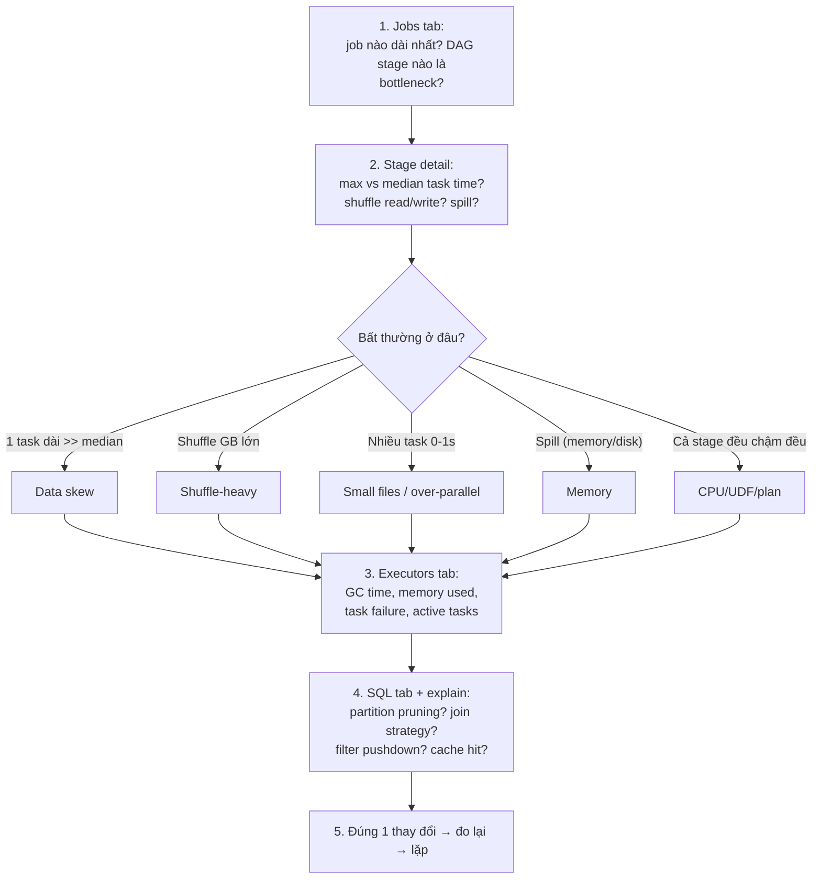

# Part 4 — Spark Optimization: chẩn đoán có hệ thống

> Nguồn đối chiếu: [Spark Tuning Guide](https://spark.apache.org/docs/latest/tuning.html) (Data Serialization, Memory Tuning, Level of Parallelism, Broadcasting) · Spark UI docs

## 1. Quy trình 5 bước với Spark UI (nói được flow = điểm cộng lớn)



Chi tiết từng bước:

1. **Jobs**: xếp theo Duration; mở DAG visualization xác định stage tắc (stage có shuffle write khổng lồ thường là thủ phạm).
2. **Stage**: Summary Metrics — so `max` vs `median` (chênh >3x = skew); cột `Shuffle Read/Write`, `Spill (memory/disk)` trong agregate metrics.
3. **Executors**: `GC Time` cao (>% thời gian task) = memory bệnh; Storage Memory full + evictions = cache bệnh.
4. **SQL**: plan có `PartitionFilters` đúng chưa, `SortMergeJoin` where đáng ra `BroadcastHashJoin`, filter nằm sau scan (không pushdown).
5. **Fix một thứ, đo lại, so số** — đừng shotgun 5 config cùng lúc.

## 2. Bảng 9 bệnh: triệu chứng → toa thuốc

| # | Bệnh | Triệu chứng trong UI | Toa thuốc |
|---|---|---|---|
| 1 | **Data skew** | Stage có 1 vài task dài >> median; 1 executor chạy dai dẳng trong khi khác xong | Salting key (`key + rand`), `broadcast join` bảng nhỏ, bật AQE (`spark.sql.adaptive.skewJoin`), `bucket(N, key)` của Iceberg/Hudi, `repartition` trước aggregate |
| 2 | **Shuffle-heavy** | Shuffle Read/Write hàng chục GB, network I/O cao | `reduceByKey` thay `groupByKey`, `broadcast` dimension, filter/project sớm (chọn ít cột), pre-partition data (Iceberg `bucket`) |
| 3 | **Small files** | Hàng nghìn task chạy 0–1s, listing input rất chậm (tệ trên S3), driver chịu tải | `coalesce` khi write, compact định kỳ (`OPTIMIZE` / `rewrite_data_files`), tránh partition theo cột cardinality cao, ghi partition động hợp lý |
| 4 | **Spill** | Cột Spill (memory/disk) > 0 lớn trong stage metrics | Tăng số partition (chia nhỏ task), tăng executor memory/`memoryOverhead`, giảm cột/dữ liệu mỗi record, Kryo serialization gọn hơn |
| 5 | **UDF chậm (Python)** | Task time cao dù không shuffle/spill; SerDe giữa JVM↔Python | Thay bằng built-in SQL functions, `mapInPandas`/pandas UDF (Arrow batch), viết bằng Scala/Java nếu bắt buộc |
| 6 | **GC / OOM** | Executors tab: GC time cao, executor lost, heap dump | Giảm `spark.memory.fraction` nếu Old Gen đầy (thà cache ít hơn), cache serialized (`MEMORY_AND_DISK_SER` + Kryo), giảm object overhead, xem G1 tuning |
| 7 | **Sai join strategy** | Plan: `SortMergeJoin` với dim vài MB | `spark.sql.autoBroadcastJoinThreshold` đúng / `broadcast(df)` hint, cập nhật statistics, AQE tự convert khi biết size thật |
| 8 | **Sai parallelism** | Số task < tổng core (cluster nhàn rỗi) hoặc task quá dài | Mục tiêu **2–3 task/core**; `spark.default.parallelism`, `spark.sql.shuffle.partitions` (mặc định 200 — thường tăng theo `total_cores × 2–3`), AQE coalesce tự động phần thừa |
| 9 | **Cache dùng sai / locality** | Recompute stage lặp lại; storage eviction; task chờ `ANY` locality | Cache đúng tầng dùng lại nhiều lần, `unpersist()` sau dùng, `MEMORY_AND_DISK_SER` thay `MEMORY_ONLY`, tăng `spark.locality.wait` khi task dài & data xa |

## 3. Configs đáng nhớ — bám sát Spark Tuning Guide

### Serialization (mục đầu tiên của Tuning Guide — "thứ đầu tiên nên tune")

```python
spark.conf.set("spark.serializer", "org.apache.spark.serializer.KryoSerializer")
conf.registerKryoClasses([MyClass1, MyClass2])   # đăng ký class = gọn & nhanh nhất
# spark.kryoserializer.buffer: đủ lớn cho object lớn nhất
```

- Kryo nhanh & gọn hơn Java serialization **đến ~10x** (theo Tuning Guide); dùng cho cả shuffle và cache serialized.

### Memory model (phải vẽ được)

```
Executor heap
├── Reserved 300 MiB (spark.executor.memoryOverhead nằm ngoài heap)
└── (heap − 300 MiB)
    ├── M = spark.memory.fraction (mặc định 0.6)   ← Unified region
    │     ├── Execution (shuffle/join/sort/agg)    ← có thể mượn lẫn,
    │     └── Storage (cache)  R = storageFraction    execution được
    │         (0.5 × M)                             eviction storage
    └── 40% còn lại: user data structures, metadata, buffer OOM
```

- Tăng `memory.fraction` = liều lĩnh hơn với OOM; giảm nếu Old Gen đầy / GC đau (Tuning Guide khuyến nghị *cache ít hơn còn hơn làm chậm task*).
- Tính Eden nhanh: đọc HDFS block 128MB giải nén ~2–3x → 4 task × 3 × 128MB cho Young gen (ví dụ nguyên văn của guide).

### Parallelism & broadcast

| Config | Giá trị tham khảo | Ghi chú |
|---|---|---|
| `spark.default.parallelism` | `total_cores × 2–3` | Tuning Guide: *"we recommend 2-3 tasks per CPU core"* |
| `spark.sql.shuffle.partitions` | `total_cores × 2–3` (mặc định 200) | AQE tự coalesce phần dư |
| `spark.sql.autoBroadcastJoinThreshold` | 10MB mặc định | Nhớ: broadcast **giảm shuffle + fix skew** cho dim nhỏ |
| `spark.sql.adaptive.enabled` | `true` | AQE: coalesce partition + demote broadcast + skew join splitting |
| Task size | > 20 KiB serialized là đáng оптим | Tuning Guide: task to = nên broadcast biến lớn ra |

**Broadcast variable** (khác broadcast *join*): lookup table tĩnh gửi 1 lần tới mọi executor thay vì nằm trong mỗi task — giảm kích thước task launching.

## 4. Join strategies — đọc plan như bác sĩ đọc X-quang

```
BroadcastHashJoin   nhỏ × lớn        tốt nhất (không shuffle)
ShuffledHashJoin    vừa × vừa        1 lần shuffle, hash build
SortMergeJoin       lớn × lớn        shuffle + sort 2 phía (đắt, ổn định)
BroadcastNestedLoopJoin  non-equi    thường = dấu hiệu viết sai query
CartesianProduct   cross join        gần như luôn là bug
```

## 5. Checklist act-before-tune (tối ưu code trước config)

1. Push filter/selected-columns sớm nhất có thể (đặc biệt trước shuffle/join).
2. Tránh `groupByKey().mapValues(...)` — dùng `reduceByKey`/`aggregateByKey`.
3. Bỏ `SELECT *`; partition pruning (điều kiện chứa partition column — Iceberg hidden partition giúp việc này tự nhiên).
4. Nhìn plan trước khi nhìn config: `df.explain(True)`.
5. Chỉ cache khi tái sử dụng ≥2 lần và thật sự đắt.

## 6. Câu chốt 30 giây

> "Tôi tối ưu theo trình tự: đúng query plan → đúng partitioning/skew handling → đúng serialization (Kryo) → cuối cùng mới là memory/executor sizing. Spark UI cho biết bệnh gì, không đoán mò."

## 7. Câu hỏi phỏng vấn thường gặp

1. Job chạy 3 giờ, làm gì đầu tiên? *(Jobs tab → stage → max/median task time — kể flow 5 bước ở trên)*
2. `coalesce()` vs `repartition()`? *(coalesce gộp ít shuffle; repartition shuffle đều — full shuffle)*
3. `groupByKey` nguy hiểm thế nào? *(đưa toàn bộ values mỗi key về 1 executor — OOM + shuffle to; reduceByKey partial-aggregate tại map side)*
4. Vì sao shuffle là kẻ thù số 1? *(network + disk I/O, serialization, boundary của stage)*
5. AQE thay đổi gì? *(plan thích ứng theo runtime stats: coalesce, broadcast demote, skew split — nhiều toa thuốc cũ giờ tự động)*

*[← Part 3](part-3-storage-formats.md) · [Part 5 →](part-5-interview-playbook.md)*
